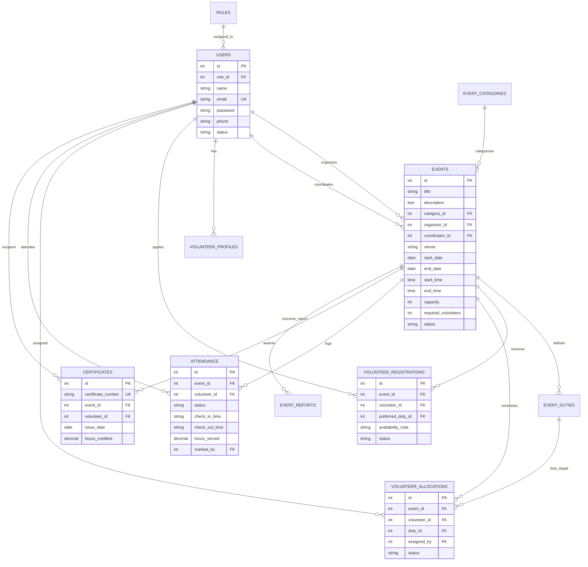

# CommunityConnect – Community Event Management and Volunteer Registration System

**SR University — Department of Computer Science & Engineering**  
**B.Tech IV Year I Semester | DevOps & Full Stack Development | Academic Year 2026–2027**  
**Student Individual Capstone Project**

---

## 🌟 1. Project Overview

**CommunityConnect** is a full-stack, enterprise-grade community engagement platform designed to bridge civic volunteers, community organizers, university coordinators, and system administrators. It streamlines the end-to-end community service lifecycle: from event inception and administrative review to volunteer capacity matching, task duty allocation, check-in attendance auditing, and automated tamper-proof credential certification.

### Core Value Proposition
- **Multi-Role Access Control (RBAC):** Distinct interfaces for **Admin**, **Event Organizer**, **Volunteer**, and **Field Coordinator**.
- **Real-Time Data Pipelines:** Real database-driven dashboards with Recharts analytics and zero static mocking.
- **Volunteer Capacity & Conflict Protection:** Enforces maximum caps and prevents overlapping shift assignments.
- **Digital Certificates:** Generates cryptographic serial-tagged PDF commendation certificates using `jsPDF`.
- **Institutional Reports Engine:** Event Participation, Duty Allocations, Shift Attendance, and Event Outcomes reports with CSV, PDF, and Print export capabilities.

---

## 🏛️ 2. Architectural Diagram

```
+-----------------------------------------------------------------------------------+
|                                 CLIENT TIER                                       |
|  React 18 + TypeScript + Tailwind CSS + Lucide Icons + Recharts Analytics + jsPDF |
+-----------------------------------------+-----------------------------------------+
                                          |
                                          | HTTP / REST (JWT Bearer Token)
                                          v
+-----------------------------------------------------------------------------------+
|                                BACKEND TIER                                       |
|               Express.js (Node.js 22 LTS) on Port 5001                            |
|                                                                                   |
|  [ Auth & RBAC ]  -->  [ Events API ]     -->  [ Registrations & Quota ]          |
|  [ Duty Alloc ]   -->  [ Live Check-in ]  -->  [ Certification Engine ]           |
|  [ Audit Logs ]   -->  [ Notification Hub ]                                       |
+-----------------------------------------+-----------------------------------------+
                                          |
                                          | Dual-Driver Data Layer (Unified Query)
                                          v
+-----------------------------------------------------------------------------------+
|                                DATABASE TIER                                      |
|    Production: MySQL 8.0 (Docker/K8s)  |  Development: SQLite 3 (Zero Setup)      |
|                                                                                   |
|  - users                 - event_categories        - events                       |
|  - event_duties          - volunteer_registrations - volunteer_allocations        |
|  - attendance            - certificates            - event_reports                |
+-----------------------------------------------------------------------------------+
```

---

## 🗄️ 3. Database Entity Relationship (ER) Diagram



---

## 👥 4. Roles and Permissions Matrix

| Feature / Endpoint | Admin | Organizer | Coordinator | Volunteer |
| :--- | :---: | :---: | :---: | :---: |
| **System Dashboard & Telemetry** | Full Analytics | Organizer Stats | Coordinator Stats | Personal Stats |
| **User & Role Management** | ✅ Complete | ❌ | ❌ | ❌ |
| **Event Creation & Editing** | ✅ | ✅ (Own Events) | ❌ | ❌ |
| **Event Administrative Approval** | ✅ | ❌ | ❌ | ❌ |
| **Volunteer Registration** | ❌ | ❌ | ❌ | ✅ Self-Registration |
| **Application Approval / Reject** | ✅ | ✅ | ✅ | ❌ |
| **Duty Role Creation & Quotas** | ✅ | ✅ | ✅ | ❌ |
| **Volunteer Duty Allocation** | ✅ | ✅ | ✅ | ❌ |
| **Mark Live Attendance** | ✅ | ✅ | ✅ | ❌ |
| **View Attendance & Service History**| ✅ | ✅ | ✅ | ✅ Self-Only |
| **Batch / Single Certificate Issue** | ✅ | ✅ | ✅ | ❌ |
| **Download PDF Certificates** | ✅ | ✅ | ✅ | ✅ Self-Earned |
| **Institutional Reports & Exports** | ✅ Full 4 Reports | ✅ Full 4 Reports | ✅ Full 4 Reports | ❌ |

---

## ⚡ 5. Demo Credentials (Ready for Viva & Evaluation)

| Role | Email | Password | Pre-seeded Features to Inspect |
| :--- | :--- | :--- | :--- |
| **Admin** | `admin@communityconnect.edu` | `Password@123` | System telemetry, Pending approvals, User directory, Global Reports |
| **Organizer** | `organizer@communityconnect.edu` | `Password@123` | Event publisher, Application review, Duty creator, Event reports |
| **Coordinator**| `coordinator@communityconnect.edu` | `Password@123` | Assigned drives, Volunteer duty scheduler, Live attendance marker |
| **Volunteer** | `volunteer@communityconnect.edu` | `Password@123` | Event registration, Duty status, Service hours (18.5 hrs), PDF Certificate |

*Note: In the web UI, you can also use the **"Switch Role View"** buttons in the sidebar or login page for seamless 1-click evaluation without typing credentials.*

---

## 🚀 6. Installation and Running Locally

### Prerequisites
- **Node.js**: v18+ (tested on Node v22 LTS)
- **npm**: v9+

### Step 1: Start Backend API
```bash
cd backend
npm install
npm run dev
```
*The backend automatically bootstraps the database schema, creates demo events, users, and audit records on port **5001**.*

### Step 2: Start Frontend Application
```bash
cd frontend
npm install
npm run dev
```
*Frontend starts at `http://localhost:5173` with configured API proxying to backend.*

---

## 🐳 7. Docker and Kubernetes Deployment

### Docker Compose
Run the entire production stack (MySQL 8 + Node Backend + Nginx Frontend) with one command:
```bash
docker compose up --build
```
- Frontend: `http://localhost`
- Backend API: `http://localhost:5001/api`
- MySQL Port: `3306`

### Kubernetes Deployment
```bash
# 1. Apply Namespace, ConfigMap, Secrets, and Persistent Volumes
kubectl apply -f k8s/deployment.yaml

# 2. Verify pods
kubectl get pods -n community-connect

# 3. Check services
kubectl get svc -n community-connect
```

---

## 🧪 8. Automated Testing

The backend includes a comprehensive test suite testing database constraints, authorization, registrations, and certificate hashes:
```bash
cd backend
npm test
```

Test coverage:
- ✅ Roles seeding & foreign keys integrity
- ✅ bcrypt password verification
- ✅ Event CRUD with status state transitions
- ✅ Duplicate registration prevention
- ✅ Attendance service hours calculation
- ✅ Certificate uniqueness and validation

---

## 🎓 Academic Declaration
This project is developed as an individual academic capstone project for **SR University, B.Tech IV Year I Semester, DevOps & Full Stack Development, Academic Year 2026–2027**.
